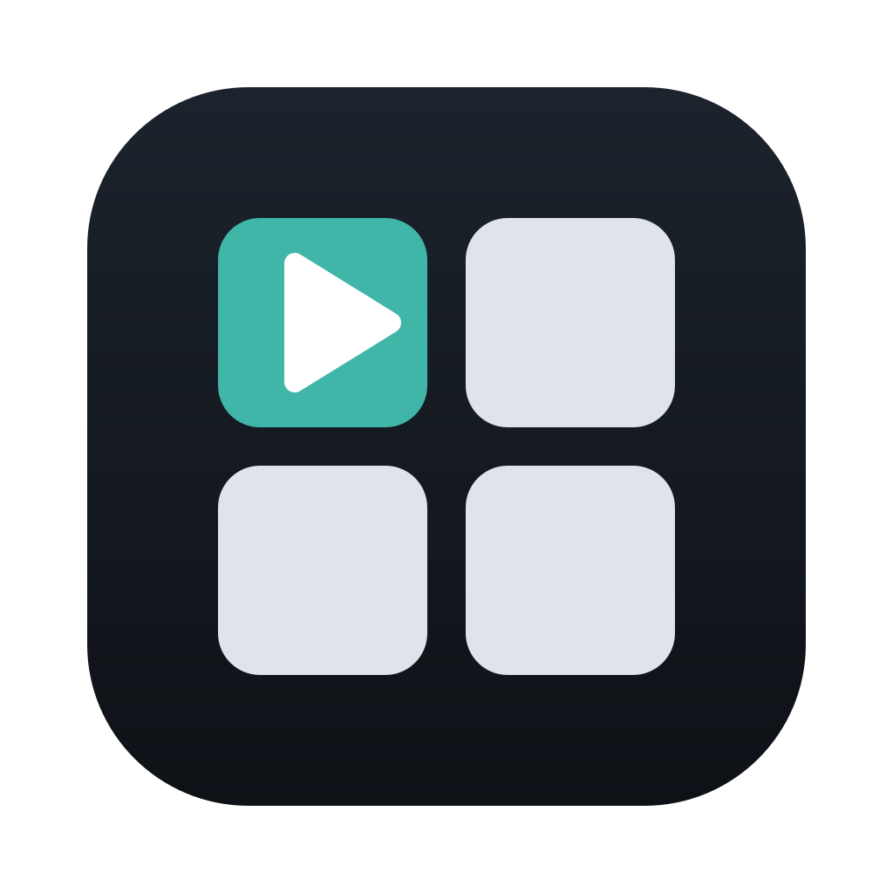

<p align="center">
  
</p>

<h1 align="center">Splitwatch</h1>

<p align="center">
  <strong>Every sport. Every stream. One screen.</strong><br>
  Watch several YouTube sports live streams side by side, in one window. Free and open source, for
  Windows and macOS (Linux, experimental).
</p>

<p align="center">
  <a href="https://github.com/MehmetBurakTaskaya/splitwatch/releases/latest">Download</a> ·
  <a href="#türkçe">Türkçe</a> ·
  <a href="CHANGELOG.md">Changelog</a> ·
  <a href="docs/ROADMAP.md">Roadmap</a>
</p>

![A short tour of Splitwatch. The start screen wears the Track theme and goes through Turkish, Japanese, Arabic, German and Spanish. A swimming stream is added by its link, its sport is set to Swimming, and the window turns to the Pool theme. Three swimming streams play side by side next to an empty place with lane ropes, another stream is picked to be heard, and the layout changes to one large stream with a side strip. Athletics, volleyball, basketball, alpine skiing and ice hockey streams each bring their own theme, in light and dark. Four streams of different sports keep a neutral window, each with its sport's color, first light, then dark. It ends with: Every sport. Every stream. One screen. 12 sport themes, 12 languages, free and open source, for Windows and macOS.](docs/assets/demo.gif)

Paste a YouTube link, or pick a live stream from the official channels of 18 sports, and Splitwatch
puts it in a grid next to the others: up to nine at once. The stream you pick is the one you hear.
The window dresses itself in the sport you watch, and everything has a key. Version 1.1; more arrives
version by version (see the [roadmap](docs/ROADMAP.md)).

## Features

- **Up to nine streams side by side.** Grids of 1, 2, 3, 4, 6 or 9 streams, or one large stream
  with a side strip. Paste a YouTube link or video ID, or copy a link and Splitwatch offers to add it.
  Drag streams to reorder them; the grid comes back next time.
- **Ready lists.** One click opens up to nine streams of a sport from its official channels, or one
  stream each of nine sports (shuffled each time): live and videos, live only, or videos only. Change
  the grid as you like (remove a stream and paste a link of your own in its place); the list stays as
  it was. A stream that cannot play in the app gives its place to the next one.
- **You hear the one you pick.** A main volume and a volume per stream. Enlarge a stream to
  fullscreen, pop one out into a window of its own for a second screen, or keep the picked stream in
  a mini player on top of other windows.
- **A theme for each sport.** Twelve sport themes, in light and dark, with backgrounds the app draws
  itself: lane ropes for swimming, the bend of a running track, waves, slalom gates and more. With
  **Automatic**, the window takes the theme of the sport you watch; pick a sport's theme, and the start
  screen suggests that sport. Make your own themes, with a check that all text stays easy to read, and
  share them as files.
- **Live sports, found for you.** "Live now" shows the newest videos of the official channels of 18
  sports. With your own free YouTube API key, it shows which are live or coming up, with a LIVE badge
  in the grid, and you can search YouTube for live streams by sport (Ctrl + K, or Cmd + K on macOS),
  get a notification when a channel goes live, and see the coming week with **Remind me**. When a
  stream ends, Splitwatch offers a live stream of the same sport in its place.
- **Summer and Winter Games modes.** The event's look, a day-by-day schedule and the medal table
  (see below).
- **For long days of sport.** Spoiler protection blurs titles and thumbnails until you point at them;
  a waiting screen counts down to the next streams; read a stream's live chat beside the grid; line up
  streams that run ahead of one another (experimental); the keyboard's media keys play, pause and
  switch streams, also from the background.
- **Saved layouts.** Save the grid under a name (Ctrl + S, or Cmd + S) and open it later, or share
  it as a `splitwatch://` link that opens it in someone else's Splitwatch (after they agree).
- **Keyboard first.** Shortcuts for everything, and you can change them.
- **Stays at hand.** Keep Splitwatch in the notification area (the menu bar on macOS) when its window
  closes, and start it when you sign in. Quiet theme sounds, off by default.
- **Your watching, on your computer.** The time you watched by week, month, sport and channel, kept
  on this computer only. Follow the channels of your YouTube subscriptions, from a Google Takeout
  export.
- **Twelve languages.** English, Spanish, Simplified Chinese, Japanese, German, French, Brazilian
  Portuguese, Arabic (right to left), Korean, Italian, Russian and Turkish. Splitwatch follows your
  system's language, or the one you pick in **Settings → Language**.
- **Keeps itself up to date**, and sends nothing about you (see [Download](#download)).

## Summer and Winter Games

When the Games are less than 30 days away, a chip in the top bar offers their mode; you can also try
any edition's mode at any time from the same chip. The mode gives Splitwatch the event's look
(floodlights for the Summer Games, the northern lights and snow for the Winter Games, also over each
sport's own background), a short opening animation the first time, and a window with:

- a day-by-day schedule: each day's sports and medal events, with the preset channels' live and
  upcoming streams of that day, **Remind me** for upcoming ones, and **Watch the finals**, which
  opens the day's live finals in one grid;
- the medal table, with your country highlighted.

The calendars come from the organizers' schedules, through the Games' articles on English Wikipedia;
the medal table is read from English Wikipedia (CC BY-SA 4.0), which volunteers keep up to date
during the Games, so it can lag behind. Splitwatch names its sources and does not use the names,
emblems or other marks of the Games or of their organizers.

| Edition                                   | Dates                         | Calendar | Medal table          |
| ----------------------------------------- | ----------------------------- | -------- | -------------------- |
| Youth Summer Games, Dakar                 | 31 October – 13 November 2026 | yes      | when its page exists |
| Summer Games, Los Angeles                 | 14–30 July 2028               | yes      | when its page exists |
| Winter Games, French Alps                 | 1–17 February 2030            | not yet  | when its page exists |
| Winter Games, Milan and Cortina d'Ampezzo | 6–22 February 2026 (past)     | yes      | yes                  |

## Playing by YouTube's rules

YouTube allows one player on a screen to start playing by itself, and no playback from a player you
cannot see. So when Splitwatch opens, only the stream you picked last starts; **Play all** in the top
bar starts the others. Streams you add start at once, since you asked for them. Streams pause while
they are out of sight (behind the enlarged stream, behind the mini player, or while the window is
minimized, or while a dialog such as Settings covers the window, since nothing may cover a player)
and go on when they come back, live streams as far behind live as they were. A stream in a window of
its own plays there instead of the grid, under the same rules. Closing the window stops them all, also
when Splitwatch stays in the notification area.

## Themes

Each theme has its own colors and a background drawn by the app: lane ropes for swimming, the bend
of a running track for athletics, waves for surfing, a slope with gates for alpine skiing, and so on.

| Theme       | Sport           | Theme    | Sport            |
| ----------- | --------------- | -------- | ---------------- |
| Pool        | Swimming        | Court    | Volleyball       |
| Track       | Athletics       | Beach    | Beach volleyball |
| Transition  | Triathlon       | Hardwood | Basketball       |
| Peloton     | Road cycling    | Swell    | Surfing          |
| Singletrack | Mountain biking | Rink     | Ice hockey       |
| Slalom      | Alpine skiing   | Halfpipe | Snowboarding     |

With **Automatic** (the default), the window takes the theme of the sport you watch. Streams added
from Live now or from a sport search know their sport; for others, Splitwatch looks for their channel
among the preset channels. When the streams show different sports, the window stays neutral and each
stream shows its own sport's color and icon. Click the icon under a stream to set its sport by hand.

The backgrounds show on the start screen, in empty places of the grid and in the thin gaps between
streams, never over a player. They move only while enough of them shows, and stop when the window is
hidden, when the system asks for reduced motion, or in **Performance mode** (Settings → Appearance).

Measured with `node scripts/measure-cpu.mjs` on an AMD Ryzen 9 7940HS laptop with Windows 11: the
CPU use of all of Splitwatch's processes, in percent of one core, averaged over 20 seconds.

| Situation                                    | Neutral | Swell theme | Swell, performance mode |
| -------------------------------------------- | ------- | ----------- | ----------------------- |
| Start screen, nothing playing                | 0.0 %   | 1.7 %       | 0.0 %                   |
| Four streams playing, two empty places shown | 2.2 %   | 2.8 %       | 2.1 %                   |

Swell, with seven moving rows of waves, is the busiest background; Pool, Track and Slalom measured
0.7 to 1.1 % on the start screen. When the players fill the grid, the background is drawn once and
costs nothing more.

Startup and memory, measured with `node scripts/measure-startup.mjs` on the same laptop while other
work kept its processor about 85 % busy: Splitwatch showed its top bar 0.3 seconds after an empty
Electron window would have shown (3.9 against 3.6 seconds, medians of five cold starts). Memory,
summed over all of its processes, was 0.5 GB on the start screen, 1.4 GB with four streams playing
and 2.0 GB with nine; most of it is YouTube's players.

### Your own themes

**Settings → Appearance → New theme** starts from the theme you see. Pick colors for light and dark,
one of the app's backgrounds and a heading font; the whole app wears the theme while you edit. A
theme whose text would be hard to read (WCAG 2.1 AA) cannot be saved, and the editor says which
colors to change. **Export…** saves a theme as a JSON file that follows
[`themes/schema.json`](themes/schema.json), and **Import…** adds one, so themes can be shared.

## Your own YouTube API key (optional)

Splitwatch works without a key: you can paste links, and "Live now" shows the newest videos of the
preset channels. A free YouTube Data API key turns on search and shows which streams are live.

1. Open the [Google Cloud Console](https://console.cloud.google.com/apis/library/youtube.googleapis.com)
   and sign in with a Google account.
2. Create a project (any name), find **YouTube Data API v3** and click **Enable**.
3. Open **Credentials → Create credentials → API key** and copy the key. Restricting it to the YouTube
   Data API v3 is a good idea.
4. In Splitwatch, open **Settings → YouTube API key**, paste it and click **Save key**.

The key is encrypted by your system (the macOS Keychain, or Windows' Data Protection API) and only
sent to YouTube. A free key allows 100 searches and 10,000 other requests a day; Settings shows how
much is left, and Splitwatch stops before the limit.

## What is coming

- Reviews of the translations by native speakers (see [CONTRIBUTING.md](CONTRIBUTING.md)).
- The later ideas on the [roadmap](docs/ROADMAP.md).

## Keyboard shortcuts

| Key         | Action                                                 |
| ----------- | ------------------------------------------------------ |
| 1 – 9       | Pick a stream (you hear it)                            |
| M           | Mute or unmute                                         |
| F           | Enlarge the picked stream, fullscreen                  |
| Esc         | Back to the grid (also from the mini player)           |
| Space       | Play or pause the picked stream                        |
| ← / →       | Back or forward 10 seconds                             |
| Alt + ← / → | Move the picked stream earlier or later                |
| L           | Next layout                                            |
| I           | Mini player                                            |
| ?           | Show the shortcuts (and change them)                   |
| Ctrl/Cmd+K  | Find a stream                                          |
| Ctrl/Cmd+S  | Save or open a layout                                  |
| Media keys  | Play/pause, next and previous stream (Settings, Sound) |

## Download

Get the latest version from [Releases](https://github.com/MehmetBurakTaskaya/splitwatch/releases/latest):

| System                                              | File                                                      |
| --------------------------------------------------- | --------------------------------------------------------- |
| Windows 10 or 11 (64-bit)                           | `Splitwatch-Setup-x64.exe`                                |
| Windows, without installing                         | `Splitwatch-Portable-x64.zip` (unzip, run Splitwatch.exe) |
| macOS 13 Ventura or later (Apple Silicon and Intel) | `Splitwatch-macOS.dmg`                                    |
| Linux (x86-64), experimental                        | `Splitwatch-x86_64.AppImage`                              |

Only the newest version is offered. Releases before 1.0.1 had the version in their file names.

Splitwatch is not code-signed yet, so both systems warn the first time.

**Windows.** If Microsoft Defender SmartScreen says "Windows protected your PC", click **More info**,
then **Run anyway**.

**macOS.** Open the `.dmg` and drag Splitwatch to Applications. The first time, macOS says the app
cannot be checked. Open **System Settings → Privacy & Security**, scroll down and click **Open Anyway**
next to the message about Splitwatch. Or run this once in Terminal:

```sh
xattr -dr com.apple.quarantine /Applications/Splitwatch.app
```

**Linux.** Make the AppImage executable (`chmod +x`) and run it. Ubuntu 23.10 and later keep apps
from the user namespaces that Chromium's sandbox uses, so an AppImage may not start there. The
safest fix is an AppArmor profile for Splitwatch that allows `userns`; starting it with `--no-sandbox`
also works but turns the sandbox off. Tray icons need a desktop with StatusNotifier support.

**Updates.** Splitwatch keeps itself up to date. It looks for a new version on GitHub at start and
every 6 hours and installs it while nobody is watching: when you close it, or while it waits in the
notification area (the menu bar on macOS), where it starts again by itself. **Update and restart** in
**Settings → Updates** installs at once. The installed and the portable Windows copy, the Mac app and
the AppImage all update themselves; on a Mac, Splitwatch has to be in Applications for that, and macOS
may ask again for the media keys' permission after an update. More in [docs/signing.md](docs/signing.md).

## Privacy

No account, no tracking, no analytics. Splitwatch talks only to YouTube (for the streams) and to
GitHub (for updates). The watch history stays on your computer; you can turn it off or clear it.
Details in [PRIVACY.md](PRIVACY.md).

## Build from source

Node.js 24 and npm.

```sh
npm ci
npm start               # build and run
npm run check           # type check, lint, format check, unit tests
npm run test:e2e        # Electron smoke tests (after npm run build)
npm run dist            # installer for the current system, in release/
```

How the code is organized and why: [docs/adr](docs/adr). How to help, including translations:
[CONTRIBUTING.md](CONTRIBUTING.md).

## License and trademarks

[MIT](LICENSE). Splitwatch plays videos only through YouTube's official embedded player and is not
affiliated with or endorsed by YouTube or Google. YouTube is a trademark of Google LLC.

Splitwatch is not affiliated with any sports body, league, team or broadcaster, and shows none of
their logos or marks; every theme picture and icon is its own. The theme headings use
[Oswald](https://github.com/googlefonts/OswaldFont) and [Exo 2](https://github.com/googlefonts/Exo-2.0),
under the SIL Open Font License 1.1 (the licenses ship with the app in `licenses/`).

The demo above plays highlights that FISU, the International University Sports Federation, publishes
on [its YouTube channel](https://www.youtube.com/channel/UCTo1z8OU-GBc7psIy-9-wtg) under the Creative
Commons Attribution license (CC BY 3.0). Splitwatch is not affiliated with or endorsed by FISU. The
demo is recorded with `node scripts/record-demo.mjs`.

## Türkçe

**Her spor, her yayın, tek ekranda.** Yukarıdaki kısa tanıtımda FISU'nun (Uluslararası Üniversite
Sporları Federasyonu) YouTube kanalında CC BY 3.0 lisansıyla yayımladığı özet videolar oynar.

Splitwatch, birden çok YouTube spor canlı yayınını tek pencerede yan yana izlemeye yarayan ücretsiz
ve açık kaynaklı bir masaüstü uygulamasıdır (Windows ve macOS). Sürüm 1.1:
YouTube bağlantısı ya da video kimliği yapıştırarak en fazla dokuz yayını bir ızgarada izleyebilirsiniz;
seçtiğiniz yayının sesini duyarsınız. "Şimdi canlı" 18 sporun resmî kanallarındaki yayınları gösterir;
kendi ücretsiz YouTube API anahtarınızla (Ayarlar → YouTube API anahtarı) canlı yayın araması ve CANLI
etiketleri de açılır. On iki spor teması, izlediğiniz sporun renklerini ve uygulamanın kendi çizdiği
bir arka planı getirir; ayarlar Ayarlar → Görünüm bölümündedir. Düzenleri bir adla kaydedip
yeniden açabilir (Ctrl + S), seçili yayını diğer pencerelerin üstünde duran küçük bir mini
oynatıcıda izleyebilir (I), Splitwatch'u pencere kapanınca bildirim alanında tutabilir ve oturum
açılınca başlatabilirsiniz. API anahtarınızla, takip ettiğiniz bir kanal canlı yayına başlayınca
bildirim alırsınız.

Ayrıca: düzenleri `splitwatch://` bağlantısıyla paylaşabilir, önümüzdeki haftanın yaklaşan
yayınları için hatırlatma kurabilir, spoiler korumasını açabilir (başlıklar ve küçük resimler
üzerlerine gelinene kadar bulanık kalır) ve klavyenin medya tuşlarını kullanabilirsiniz. Biten bir
yayının yerine aynı sporun canlı bir yayını önerilir.

Yaz Oyunları ve Kış Oyunları modları, oyunlara 30 günden az kalınca üst çubuktaki etiketle
önerilir (her an denenebilir): etkinliğin görünümü, açılış animasyonu, gün gün program (o günün
canlı ve yaklaşan yayınları, hatırlatma, günün finallerini tek ızgarada açma) ve ülkenizin
vurgulandığı madalya tablosu (İngilizce Wikipedia'dan, CC BY-SA 4.0).

YouTube kuralları gereği açılışta yalnız son seçtiğiniz yayın kendiliğinden başlar; diğerlerini üst
çubuktaki **Tümünü oynat** başlatır. Görünmeyen yayınlar (büyütülmüş yayının ya da mini oynatıcının
arkasında kalanlar, pencere simge durumundayken ya da Ayarlar gibi bir pencere açıkken) duraklar ve
göründüklerinde devam eder.

0.8 ile gelenler: bir yayını ayrı bir pencereye alabilir (ikinci ekran için), yayının canlı
sohbetini ızgaranın yanında okuyabilir (yazmak için sohbet tarayıcıda açılır), birbirinden önde
giden yayınları saniye saniye geri alıp hizalayabilir (deneysel), kendi temalarınızı yapıp dosya
olarak paylaşabilir, izleme geçmişinizi ve istatistiklerinizi görebilir (yalnız bilgisayarınızda
tutulur, Ayarlar'dan kapatılıp silinebilir), sıradaki yayınlara geri sayan bir bekleme ekranı
açabilir, sessiz tema seslerini açabilir (varsayılan kapalı) ve Google Takeout'tan aldığınız
`subscriptions.csv` ile YouTube aboneliklerinizdeki kanalları takip edebilirsiniz.

0.9 ile arayüz Türkçe dahil on iki dilde: Splitwatch sisteminizin dilini kullanır; başka bir dili
**Ayarlar → Dil** bölümünden seçebilirsiniz. Çeviriler henüz anadili o dil olan biri tarafından
kontrol edilmedi; düzeltmelerinizi GitHub'da bekliyoruz.

1.0 ile ilk açılışta kısa bir tanıtım çıkar ve yeni bir simge gelir. 1.0.1'den beri Splitwatch kendini
her zaman güncel tutar: açılışta ve 6 saatte bir GitHub'da yeni sürüm arar, kimse izlemiyorken
(kapatıldığında ya da bildirim alanında beklerken) yükler; **Ayarlar → Güncellemeler** bölümündeki
**Güncelle ve yeniden başlat** hemen yükler. Taşınabilir Windows sürümü ve Mac de kendini günceller.
İndirme sayfasında yalnız en yeni sürüm bulunur.

1.1 ile **Hazır listeler** geldi: tek tıkla bir spor dalının resmî kanallarından en fazla dokuz yayını
ya da dokuz ayrı spor dalından birer yayını (her seferinde karışık) yan yana açarsınız; "Canlı ve
videolar", "Yalnızca canlı" ya da "Yalnızca videolar" seçilebilir. Izgarada istediğinizi değiştirin
(bir yayını çıkarıp yerine kendi bağlantınızı yapıştırın); liste olduğu gibi kalır. Uygulamada
oynatılamayan bir yayının yerini sıradaki alır. Görünüm bölümünde bir spor dalının temasını
seçerseniz başlangıç ekranı o dalı önerir. Tenis eklendi ve spor dallarının çoğuna yeni resmî kanallar
geldi.

İndirmek için [Releases](https://github.com/MehmetBurakTaskaya/splitwatch/releases/latest) sayfasına
gidin. Uygulama henüz kod imzalı olmadığı için ilk açılışta uyarı çıkar:

- **Windows:** "Windows bilgisayarınızı korudu" uyarısında **Ek bilgi**'ye, sonra **Yine de çalıştır**'a
  tıklayın.
- **macOS:** `.dmg` dosyasını açıp Splitwatch'u Uygulamalar klasörüne sürükleyin. İlk açılışta
  **Sistem Ayarları → Gizlilik ve Güvenlik** bölümünde **Yine de Aç**'a tıklayın ya da Terminal'de
  yukarıdaki `xattr` komutunu bir kez çalıştırın.

Kurmadan çalıştırmak için Windows ZIP'i, Linux için (deneysel) AppImage'ı indirebilirsiniz.
Hepsi kendini günceller.
